# Float Sim RAO solver: literature review and Capytaine comparison

24 November 2026

## Summary

Float Sim's panel method and Capytaine, run independently, give the same RAOs for all 12 test models. Away from resonances they agree within 4.3 % of each motion's peak, and within 1 % for most motions. At resonances, natural frequencies agree within 1.2 % and radiation damping ratios within 3 %.

- **Scope:** all 12 models, 0.01–1 Hz, headings 0–180° every 10°, all six motions.
- **Independence:** Capytaine was run outside the Float Sim interface, on its own meshes, with its own hydrostatics and RAO solver.
- **Arbiter:** both solvers satisfy the Haskind energy relation within 3 %. That relation decided the one real discrepancy found on the way, which was a set-up error on the Capytaine side and is explained under Limits.
- **In the app:** Float Sim can now also hand its panel mesh to Capytaine on the user's computer with a **Solve with Capytaine** button. On the same mesh the two agree within 0.5 % for translations and 2.1 % for rotations.

## Literature review

The earlier review (20 Nov 2026, [rao-trade-study.md](rao-trade-study.md)) found that Float Sim's original Froude–Krylov model got wave forces right only for bodies small against the wavelength, and that its estimated added mass and damping caused most of the error near resonance. That is why Float Sim now has a radiation–diffraction panel method.

The review compared the original model with exact and published solutions:

1. **Horizontal force on slender bodies.** Froude–Krylov alone is 50 % low on a 0.5 m × 6 m spar in long waves: it gives an inertia coefficient C<sub>m</sub> = 1 instead of 2. A long-wave diffraction correction brings the sway force within 4.6 % of MacCamy–Fuchs up to ka = 0.7. It is on by default for surge and sway.
2. **Heave force.** Froude–Krylov overpredicts the hemisphere's heave force by up to 41 %. The same correction fixes long waves (2.2 % up to ka = 0.3) but overcorrects towards resonance (−69.6 % at ka = 1), so it is off by default for heave.
3. **Added mass and damping estimates.** With the default floating-disk added mass and 15 % critical damping, the hemisphere heave RAO is 25.7 % low at resonance against Hulme's exact solution. Exact constant coefficients reduce that to 15.3 %; the rest is the long-wave force model.
4. **Small buoys.** The fixed 15 % damping was about 9× the real radiation damping of a cylinder buoy (1.6 %). A discus-shaped body's pitch period was 46 % too long, and the Kramer sphere's heave decay ran twice as fast as measured.
5. **Trust region.** Results degrade once ka ≳ 0.7 (D/λ ≳ 0.2), the point where the app shows its diffraction warning.

These errors come from the hydrodynamic coefficients, not from the hydrostatics or the incident-wave pressure. Fixing them needs frequency-dependent added mass A(ω), damping B(ω) and diffraction forces X(ω, β), which a panel method computes.

| Source | What it gives | Used for |
| --- | --- | --- |
| Hulme (1982), *J. Fluid Mech.* 121 ([table](https://github.com/LHEEA/Hulme_Heaving_Sphere)) | Exact heave added mass and damping of a floating hemisphere, ka 0–10 | Heave RAO and force checks; panel-method check |
| MacCamy & Fuchs (1954) | Exact diffraction force on a vertical cylinder | Spar sway force and RAO |
| Lamb (1932) §373 | Exact added mass of a prolate spheroid | Panel-method check on slender bodies |
| Kramer et al. (2021), *Energies* 14, 269 | Measured heave decay of a 0.3 m floating sphere, with WAMIT coefficients | Drop test and panel-method check |
| WAMIT v7 runs (WEC-Sim BEMIO examples) | A, B, X of a hemisphere, an ellipsoid and a cylinder buoy | Panel-method check |
| WAMIT runs in [OpenFAST r-test](https://github.com/OpenFAST/r-test) | OC3-Hywind spar, ITI barge | Panel-method check on offshore-wind platforms |
| Capytaine 3.0 (Ancellin & Dias 2019) | Open-source panel method validated against WAMIT | Reference for six buoys and the ITI barge, and the RAO comparison below |

## Float Sim's panel method

Float Sim solves the same linear problem as WAMIT's low-order method, in deep water at zero forward speed, written from the published equations in JavaScript and run in browser workers. No Capytaine or WAMIT code is used in it.

| Part | What it does | Reference |
| --- | --- | --- |
| Integral equation | Direct (potential) formulation, constant-strength flat triangular panels, collocation at centroids: 2πφ + ∫φ ∂G/∂n = ∫ φ<sub>n</sub> G | WAMIT User Manual v7.5, ch. 15 |
| Green function | Deep water. Rankine parts 1/r + 1/r′ integrated exactly over each panel; the wave part from Newman's closed form in Struve and Bessel functions, with 3 points per panel near it or where K·size > 0.3 | Newman (1985); Abramowitz & Stegun §9, §12 |
| Irregular frequencies | An interior waterplane lid with the extended integral equations | WAMIT eq. 15.42–15.43 |
| Outputs | A(ω), B(ω) from ρ∫n<sub>i</sub>φ<sub>j</sub>; X(ω, β) from the Haskind relation; RAOs from [−ω²(M + A) + iω(B + B<sub>extra</sub>) + C] ξ = X about G | Newman (1962) |
| Symmetry | One or two vertical mirror planes found from the wetted surface; one block per parity class, up to 64× less solve work | |
| Linear solve | Restarted GMRES above 600 unknowns, dense LU below | Saad & Schultz (1986) |
| Meshing | Isotropic remeshing of the CAD wetted surface, keeping sharp edges, the waterline and symmetry cuts; refined to 2πR/20 on curved surfaces; lid built from the waterline loops, moonpools included | Botsch & Kobbelt (2004) |

Capytaine solves the same direct integral equation on flat panels, but tabulates the wave part of the Green function (Delhommeau's method) and integrates excitation from pressure instead of the Haskind relation. Agreement between the two is therefore a check of two independent implementations.

## Coefficient validation

Before the RAO comparison, Float Sim's added mass, damping and wave forces were checked coefficient by coefficient. They are within 2 % of WAMIT and Capytaine for translations and 5 % for rotations on nine bodies.

Largest error over frequency, relative to each coefficient's peak, Standard mesh ([bem-validation.md](bem-validation.md), `test/validate-bem.mjs`, 35 of 35 checks pass). Limits: 2 % translational, 5 % rotational and coupling.

| Body | Reference | Surge, sway, heave: worst | Rotations and couplings: worst |
| --- | --- | --- | --- |
| Hemisphere r 5 m | WAMIT | B33 0.78 % | B55 0.41 % |
| Ellipsoid 9 × 3.6 m | WAMIT | **B33 1.58 %** | B55 2.67 % |
| Cylinder buoy a 0.35 m | Capytaine | B33 0.50 % | B44 0.38 % |
| Kramer sphere D 0.3 m | Capytaine | B22 1.01 % | B15 1.43 % |
| Discus r 0.5 m, draft 0.2 m | Capytaine | B33 0.90 % | **B15 4.44 %** |
| Cube 1 m, draft 0.85 m | Capytaine | A33 0.78 % | A24 3.74 % |
| Log Ø0.4 × 3 m | Capytaine | B11 0.83 % | A15 1.49 % |
| Spar a 0.5 m, draft 6 m | Capytaine | X3 0.35 % | B44 0.26 % |
| ITI barge 40 × 40 m (worst of all coefficients) | Capytaine | 1.0 % | 2.5 % |

The same suite also checks exact and measured results:

- Hulme's exact hemisphere: heave added mass within 0.26 % at every ka from 0 to 10.
- Lamb's exact slender spheroid: added mass within 0.23 %.
- The Kramer et al. sphere: drop-test period within 0.6 % of the measured 0.76 s.
- The OC3-Hywind spar against WAMIT: within 1.1 % at Very fine panels.

The largest rotational errors are on the sharp-edged discus and cube. There, the Capytaine references themselves move by 4–11 % between two mesh sizes.

## Test models and set-up

All 12 test STEP models were solved twice, at 100 frequencies from 0.01 to 1 Hz and 19 headings from 0° to 180° every 10°. One run used Float Sim's panel method; the other used Capytaine 3.0 on its own, outside the Float Sim interface. Heading 0° means waves travelling along the model's +x axis.

- **Float Sim:** each STEP file read with OpenCascade and meshed exactly as the app does, at Standard fidelity with panels refined for 1 Hz waves. It uses the irregular-frequency lid and any symmetry the hull has, and gives RAOs about G with the wave phase at G.
- **Capytaine:** nothing taken from Float Sim's meshes or solver.
    - Each body meshed from its dimensions with Capytaine's own mesh generators and floated at its exact draft.
    - The direct formulation, with the lid from Capytaine's `generate_lid`.
    - Capytaine's own hydrostatic stiffness, and RAOs from `capytaine.post_pro.rao`.
- **Shared inputs:** mass, CoG and inertia about the CoG, the same for both, as a CAD mass-properties report would give them. No extra damping, so these are pure potential-flow RAOs, as both solvers compute them.

| Model | Floating condition | Float Sim panels + lid | Capytaine panels + lid |
| --- | --- | --- | --- |
| box_4x2x1 | Box barge 4 × 2 × 1 m, draft 0.4 m, KG 0.5 m | 1,396 + 776 | 800 + 434 |
| box_moved | Same box, yawed 30° and moved off the origin in the CAD file | 1,408 + 796 | 800 + 445 |
| buoy_cyl | Cylinder buoy a 0.35 m, draft 0.63 m, CoG 0.4 m below the waterline | 2,848 + 300 | 1,056 + 197 |
| cube_1m | 1 m cube, s.g. 0.85, CoG at the centre | 1,108 + 264 | 868 + 144 |
| hcyl_log | Log Ø0.4 × 3 m, half immersed, CoG 50 mm below the axis | 4,768 + 748 | 1,440 + 616 |
| kramer_sphere | Kramer et al. sphere D 0.3 m, CoG 34.8 mm below the centre | 1,232 + 564 | 1,088 + 392 |
| spar | Spar a 0.5 m, draft 6 m, CoG 1 m above the keel | 4,412 + 52 | 1,920 + 61 |
| sphere_r1 | Sphere r 1 m, half immersed, CoG 0.3 m below the centre | 1,300 + 616 | 1,600 + 561 |
| square_log_3x1x1 | Square log 3 × 1 × 1 m, s.g. ½, floating corner-down | 1,288 + 784 | 1,020 + 578 |
| v_prism | V-section prism, 30° half-angle, 3 m long, draft 0.6 m | 1,132 + 580 | 518 + 124 |
| vcyl_squat | Discus cylinder r 0.5 m, draft 0.2 m, CoG at the waterline | 1,220 + 644 | 896 + 354 |
| vcyl_tall | Cylinder r 0.25 m, draft 0.5 m, ballasted to KG 0.2 m | 3,496 + 280 | 640 + 90 |

On a 16-core desktop, Float Sim took 4.9 CPU-hours (23 min on 14 processes) and Capytaine 4 min. Capytaine tabulates the wave part of the Green function; Float Sim evaluates it from series at every panel pair, which is the next speed-up to make.

## RAO comparison

Away from resonances, Float Sim and Capytaine give the same RAOs within 4.3 % of each motion's peak on every model. That covers 47 of 66 motions under 1 % and 54 under 2 %.

Largest |Float Sim − Capytaine| over 0.01–1 Hz and 19 headings, away from resonances, as % of the motion's peak ([summary.csv](rao-compare/summary.csv)). — : zero by symmetry (round bodies have no yaw response).

| Model | surge | sway | heave | roll | pitch | yaw |
| --- | ---: | ---: | ---: | ---: | ---: | ---: |
| box_4x2x1 | 0.9 % | 0.6 % | 0.7 % | **4.3 %** | 1.4 % | 0.2 % |
| box_moved | 0.9 % | 0.6 % | 0.6 % | 4.2 % | 4.2 % | 0.4 % |
| buoy_cyl | 0.9 % | 0.9 % | 1.4 % | 0.8 % | 0.8 % | — |
| cube_1m | 0.1 % | 0.1 % | 0.2 % | 3.6 % | 3.6 % | 0.4 % |
| hcyl_log | 0.2 % | 0.6 % | 0.1 % | 0.6 % | 0.3 % | 0.1 % |
| kramer_sphere | 0.5 % | 0.4 % | 0.3 % | 0.4 % | 0.4 % | — |
| spar | 0.3 % | 0.3 % | 2.0 % | 0.2 % | 0.2 % | — |
| sphere_r1 | 0.7 % | 0.7 % | 0.2 % | 0.8 % | 0.8 % | — |
| square_log_3x1x1 | 0.4 % | 1.3 % | 0.1 % | 2.4 % | 0.5 % | 0.3 % |
| v_prism | 0.3 % | 0.3 % | 0.4 % | 0.1 % | 0.5 % | 0.4 % |
| vcyl_squat | 1.9 % | 2.0 % | 0.9 % | 2.8 % | 2.7 % | — |
| vcyl_tall | 1.7 % | 1.7 % | 3.2 % | 3.6 % | 3.6 % | — |

The largest differences are in roll and pitch of the sharp-edged box and cube and of the two upright cylinders, close to their resonances. There, a small shift of the resonance frequency moves a steep curve sideways.

Coupled natural frequencies, Float Sim / Capytaine, from C v = ω²(M + A(ω)) v ([natural.csv](rao-compare/natural.csv)). In brackets: the difference, and half the difference of the restoring stiffness (½ ΔC/C), which on its own would shift the frequency that much.

| Model | Heave (Hz) | Roll (Hz) | Pitch (Hz) |
| --- | --- | --- | --- |
| box_4x2x1 | 0.4875 / 0.4871 (+0.09 %; +0.00 %) | 0.4373 / 0.4351 (+0.50 %; +0.31 %) | 0.4991 / 0.4982 (+0.18 %; +0.05 %) |
| box_moved | 0.4876 / 0.4872 (+0.08 %; +0.00 %) | 0.4372 / 0.4351 (+0.49 %; +0.14 %) | 0.4991 / 0.4982 (+0.19 %; +0.07 %) |
| buoy_cyl | 0.5463 / 0.5453 (+0.18 %; +0.14 %) | 0.3989 / 0.3977 (+0.30 %; +0.28 %) | 0.3989 / 0.3977 (+0.30 %; +0.28 %) |
| cube_1m | 0.4619 / 0.4618 (+0.02 %; +0.00 %) | 0.1701 / 0.1682 (+1.14 %; +1.11 %) | 0.1702 / 0.1682 (+1.16 %; +1.11 %) |
| hcyl_log | 0.9944 / 0.9939 (+0.05 %; +0.00 %) | 0.7219 / 0.7224 (−0.06 %; −0.04 %) | 0.9823 / 0.9810 (+0.13 %; +0.01 %) |
| kramer_sphere | 1.2722 / 1.2712 (+0.07 %; +0.08 %) | 0.8996 / 0.8983 (+0.15 %; +0.16 %) | 0.8996 / 0.8983 (+0.14 %; +0.17 %) |
| spar | 0.1981 / 0.1977 (+0.21 %; +0.20 %) | 0.1094 / 0.1092 (+0.22 %; +0.22 %) | 0.1094 / 0.1092 (+0.22 %; +0.22 %) |
| sphere_r1 | 0.5122 / 0.5119 (+0.05 %; +0.04 %) | 0.3765 / 0.3762 (+0.08 %; +0.10 %) | 0.3765 / 0.3762 (+0.08 %; +0.11 %) |
| square_log_3x1x1 | 0.6055 / 0.6056 (−0.02 %; +0.00 %) | 0.4962 / 0.4953 (+0.17 %; +0.09 %) | 0.5699 / 0.5695 (+0.08 %; +0.03 %) |
| v_prism | 0.7765 / 0.7766 (−0.01 %; +0.00 %) | 0.4196 / 0.4197 (−0.01 %; −0.09 %) | 0.6941 / 0.6932 (+0.13 %; +0.03 %) |
| vcyl_squat | 0.7516 / 0.7502 (+0.19 %; +0.08 %) | 0.6672 / 0.6631 (+0.61 %; +0.37 %) | 0.6670 / 0.6631 (+0.59 %; +0.37 %) |
| vcyl_tall | 0.6201 / 0.6180 (+0.33 %; +0.20 %) | 0.3174 / 0.3159 (+0.46 %; +0.43 %) | 0.3174 / 0.3159 (+0.46 %; +0.43 %) |

At resonances, the natural frequencies agree within 1.2 %. Most of each difference comes from the hydrostatics, not the wave solution: Capytaine's faceted waterplanes and centroid-rule integration give 0.1–2.2 % less restoring stiffness than Float Sim's exact CAD values. Radiation damping ratios agree within 3 %. Resonance peak heights agree within 3 % wherever the damping is at least 0.2 % of critical; below that, peaks are needles whose height depends on the frequency grid.

### Plots for each model

Each figure has six rows, one per motion (surge, sway, heave, roll, pitch, yaw), and three columns:

- **Left:** Float Sim's RAOs.
- **Middle:** Capytaine's RAOs, on the same scale.
- **Right:** the difference, as % of the motion's peak.

There is one line per heading, light at 0° to dark at 180°. Grey bands mark the resonances, which are compared above rather than scored. Translations are in m per m of wave amplitude, rotations in degrees per m.

#### box_4x2x1: box barge 4 × 2 × 1 m, draft 0.4 m

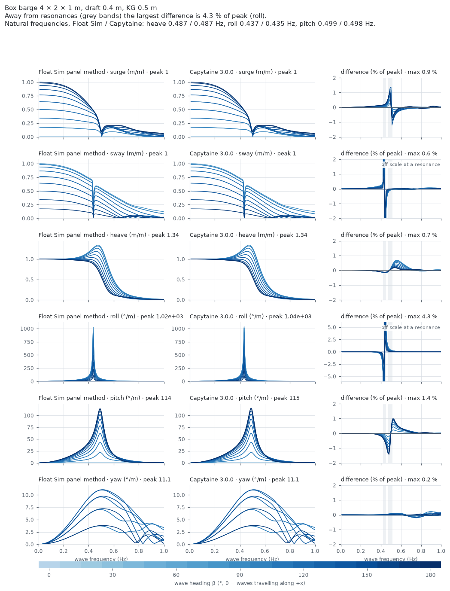

#### box_moved: the same box, yawed 30° in the CAD file

Headings are from the file's +x, so the box's own axes are turned 30°. Its natural frequencies match box_4x2x1 in both solvers.

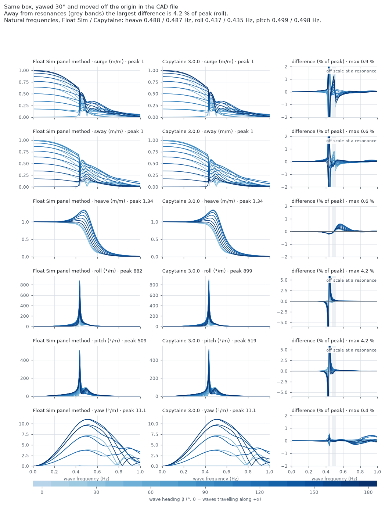

#### buoy_cyl: cylinder buoy a 0.35 m, draft 0.63 m

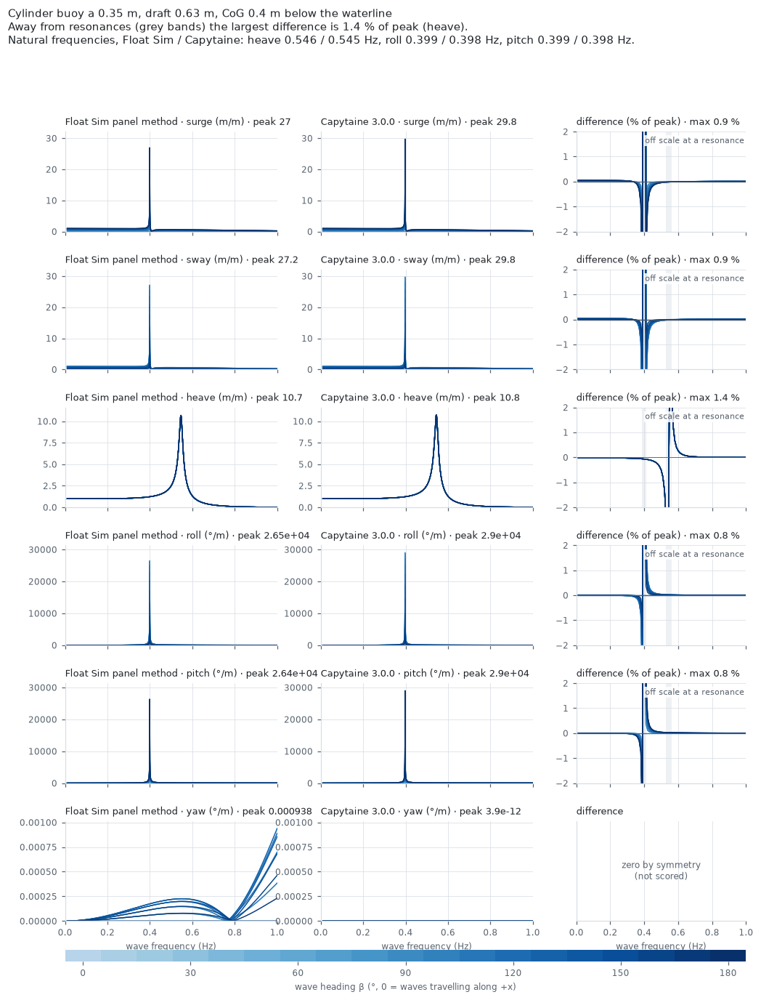

#### cube_1m: 1 m cube, s.g. 0.85

Its roll and pitch have almost no radiation damping, so those peaks are needles that the frequency grid catches at different heights.

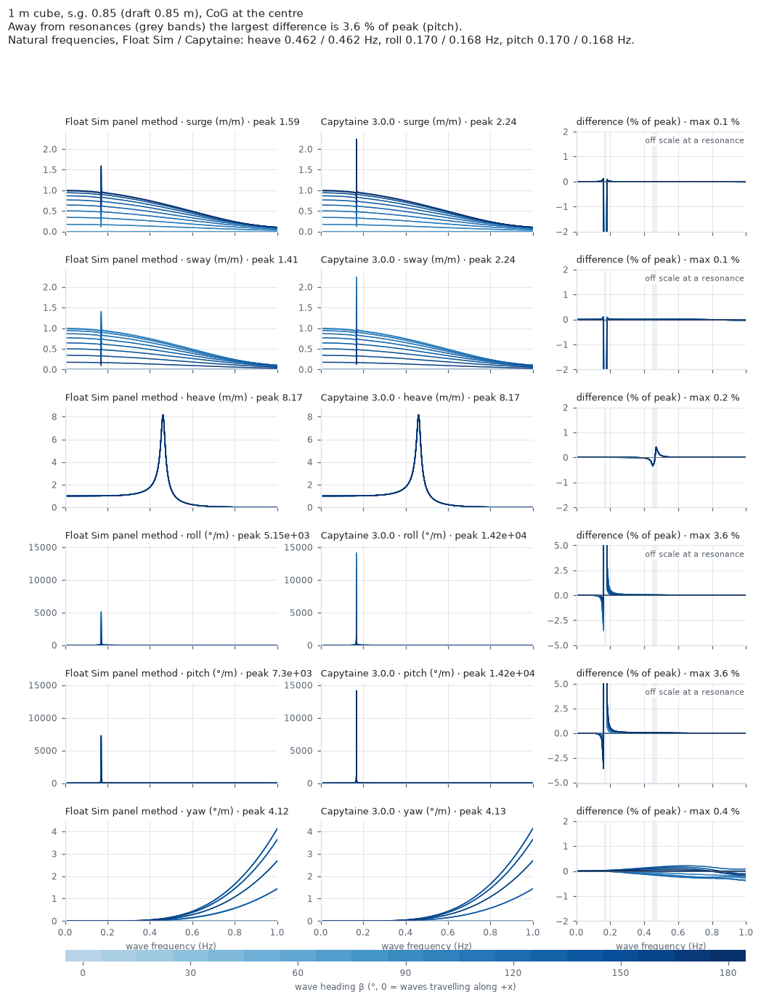

#### hcyl_log: log Ø0.4 × 3 m, half immersed

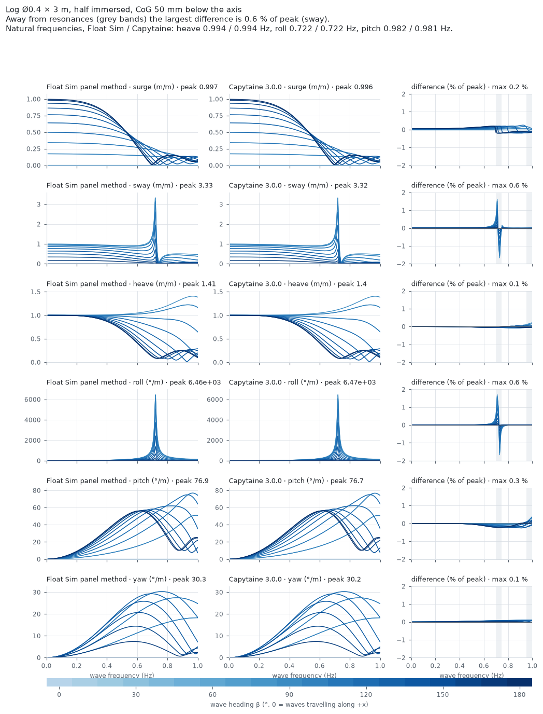

#### kramer_sphere: sphere D 0.3 m

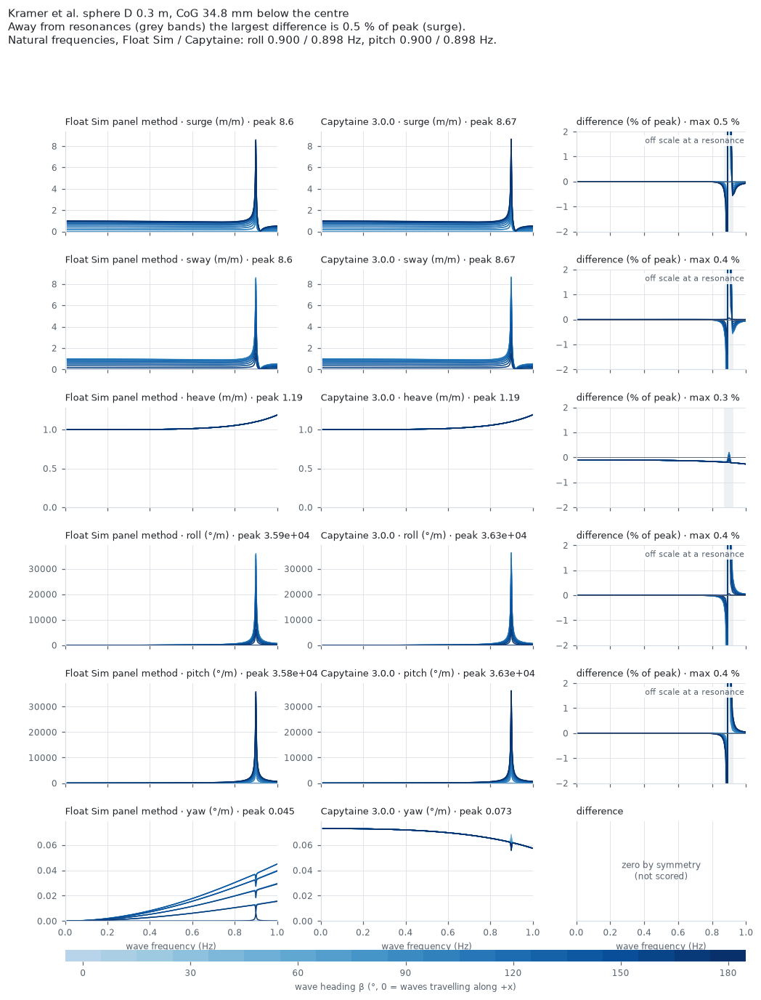

#### spar: a 0.5 m, draft 6 m

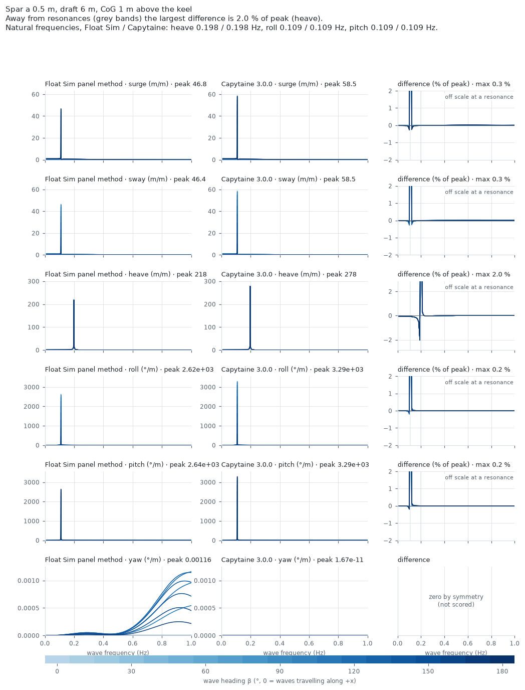

#### sphere_r1: sphere r 1 m, half immersed

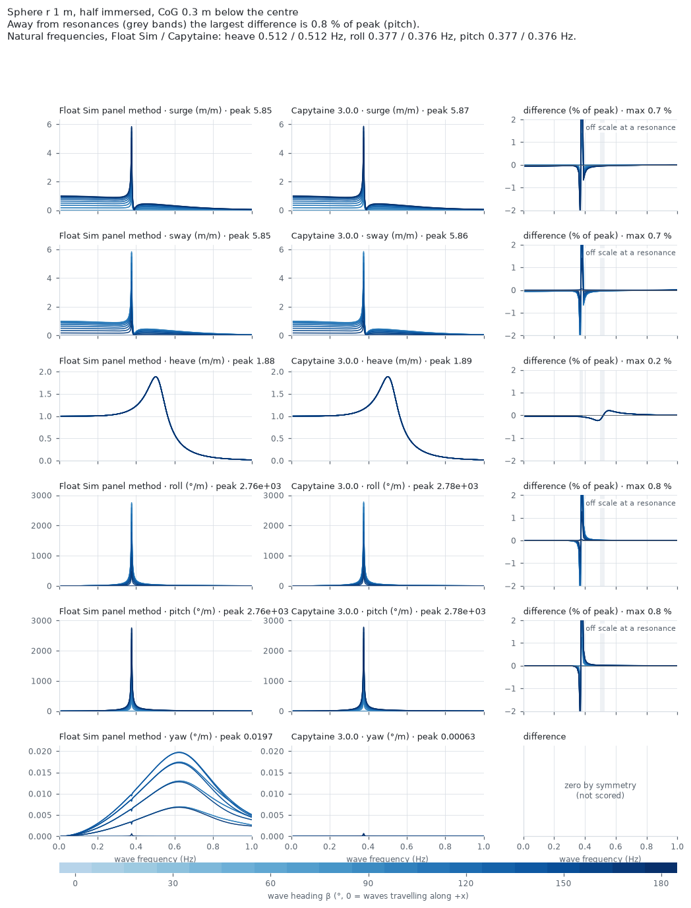

#### square_log_3x1x1: square log, floating corner-down

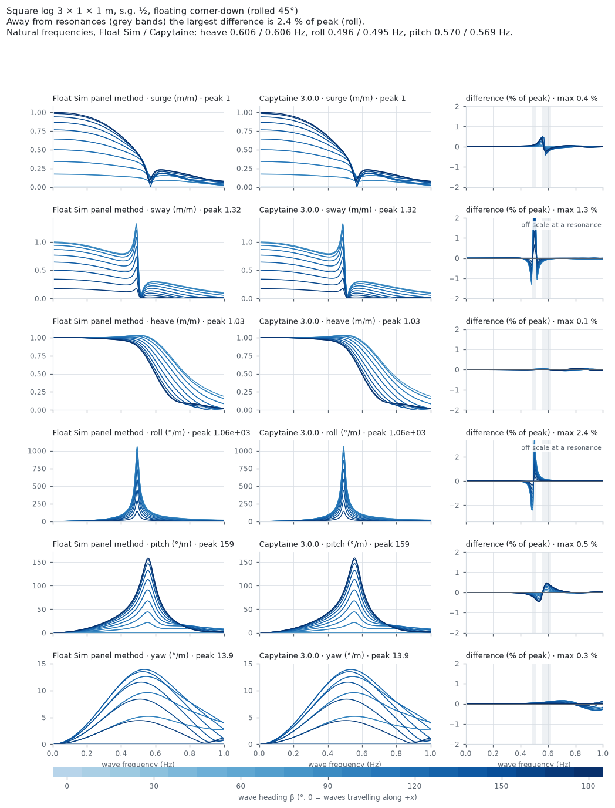

#### v_prism: V-section prism, draft 0.6 m

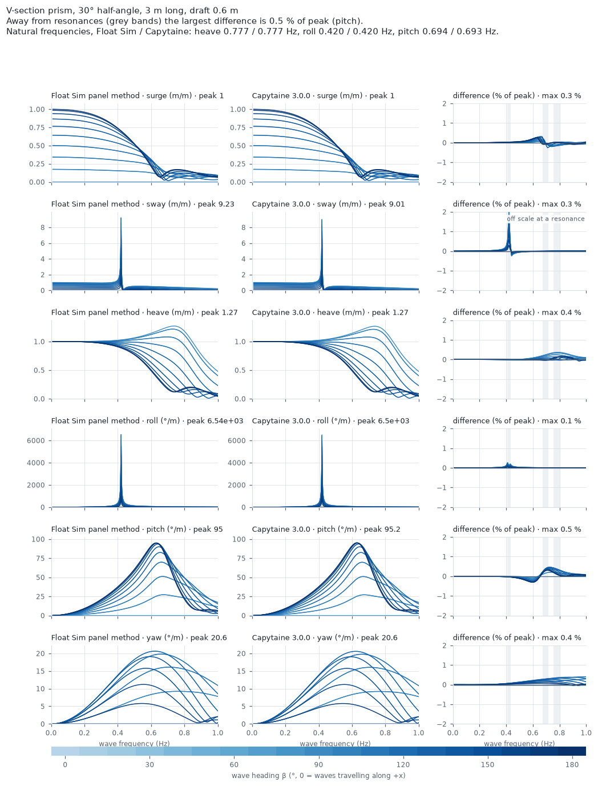

#### vcyl_squat: discus cylinder r 0.5 m, draft 0.2 m

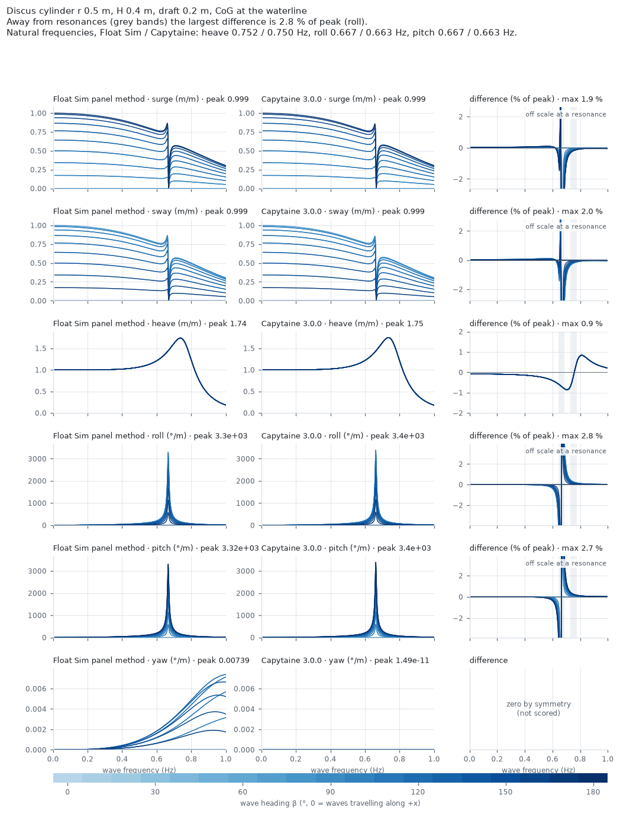

#### vcyl_tall: cylinder r 0.25 m, draft 0.5 m, ballasted

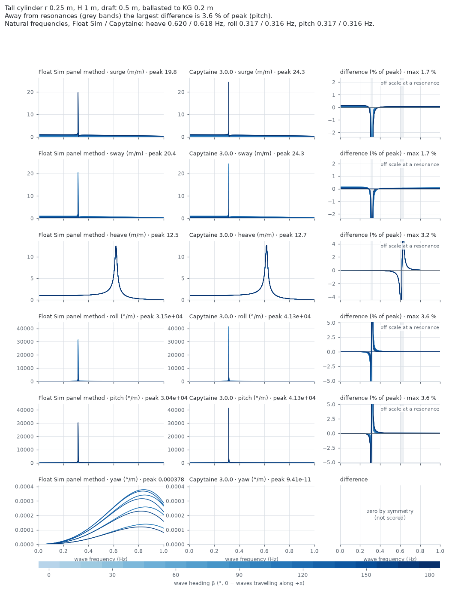

## Solve with Capytaine in the app

A **Solve with Capytaine** button now sits next to **Solve RAOs** on the RAO stage. On the same panel mesh, it gives the same added mass, damping and wave forces as Float Sim's own solver: within 0.5 % for translations and 2.1 % for rotations. The built-in solver stays the default and runs in any browser. The button is enabled only when Float Sim is started with `./serve.sh` from a Python that has Capytaine (`pip install capytaine`); otherwise it is greyed out and the Solver section says why.

What happens when it is pressed:

1. The page meshes the wetted surface exactly as for the built-in solver: same panels, waterplane lid and symmetry planes.
2. It sends the mesh, frequencies and headings to a small helper that `serve.sh` starts on this computer (`tools/serve.py`, listening on 127.0.0.1 only).
3. The helper runs Capytaine's direct formulation, one frequency per process, with as many processes as the cores and free memory allow. The progress window shows frequencies done and time left, and Cancel stops the processes.
4. Added mass, damping and wave forces come back in Float Sim's conventions. The RAOs, reference point, sea states, exports and simulators then work as before, and the info box and export headers name Capytaine as the solver.

Checks (`test/validate-capytaine.mjs`, 7 of 7 pass), Capytaine against Float Sim's solver on the same mesh:

| Case | Panels + lid | Translational, worst | Rotational, worst | Phase |
| --- | --- | --- | --- | --- |
| Cylinder buoy, two symmetry planes through G | 1,796 + 124 | 0.05 % | 0.05 % | ≤ 0.02° |
| 4 × 2 m box, CoG off both symmetry planes | 1,396 + 776 | 0.44 % | 2.11 % | ≤ 0.84° |
| Same box yawed 30° in the CAD file, no symmetry | 1,408 + 796 | 0.47 % | 1.63 % | ≤ 1.38° |

The test also checks that the helper refuses requests from other web pages and malformed meshes, and that a solve can be cancelled part-way. In the browser, a Coarse 12-frequency sweep of the box took 1.0 s with the built-in solver and 3.0 s with Capytaine on 12 processes.

## Limits

Both solvers share the same model: linear potential flow, deep water and zero forward speed. Agreement between them says nothing about effects outside that model.

- **Resonance peaks.** Potential flow gives almost no roll or pitch damping on buoys and boxes: 0.06 % of critical for the cylinder buoy, and 0.003 % or less for the spar, the cube and the tall cylinder. Their RAO peaks are needles whose height depends on where the frequency grid falls. Real peaks are set by viscous damping, which the app adds as extra ζ or as viscous drag.
- **Hydrostatics.** Float Sim's restoring matrix is exact for the CAD mesh. Capytaine integrates the waterplane at panel centroids, which shifted the cube's roll stiffness by 2.2 % (its GM is only 23 mm).
- **Capytaine lids.** A lid that covers the whole waterplane, with its edge on the hull's waterline, gave Capytaine wrong results on flat-sided bodies. For the 4 × 2 m box at 0.5 Hz, heave damping was 40 % off the Haskind energy relation and the wave force 50 % off. Capytaine's `generate_lid` avoids it. The app's button sends Float Sim's own lid, which agrees with Float Sim's solver to 2 %.
- **Deep water only.** Capytaine can solve finite depth, but the rest of Float Sim (wave field, phases, sea states) assumes deep water, so the button does too.
- **Sharp edges** converge slowly in the rotational motions with flat constant-strength panels, in both codes: the box and the cube carry the largest differences (3.6–4.3 % near their roll resonances).

## How to reproduce

Everything is in the Float Sim repository. Capytaine runs need `pip install capytaine`, and the plots need matplotlib.

```bash
# RAO comparison (test/rao-compare/, results in docs/rao-compare/)
node test/rao-compare/floatsim_rao.mjs props                  # mass properties and waterlines
node test/rao-compare/floatsim_rao.mjs run box_4x2x1 0 2      # every model and part, in parallel
node test/rao-compare/floatsim_rao.mjs merge box_4x2x1 2
python test/rao-compare/capytaine_rao.py                      # all 12 models, one frequency per process
python test/rao-compare/plot.py                               # plots, summary.csv, natural.csv

# Solve with Capytaine
FLOATSIM_PYTHON=/path/to/python ./serve.sh                    # the button is on when that Python has Capytaine
FLOATSIM_PYTHON=/path/to/python node test/validate-capytaine.mjs

# coefficient validation and the earlier trade study
node test/validate-bem.mjs
node test/trade-study-node.mjs
```

Sources: [bem-validation.md](bem-validation.md), [rao-trade-study.md](rao-trade-study.md) and [rao-compare/README.md](rao-compare/README.md) in this folder; Capytaine at [github.com/capytaine/capytaine](https://github.com/capytaine/capytaine).
